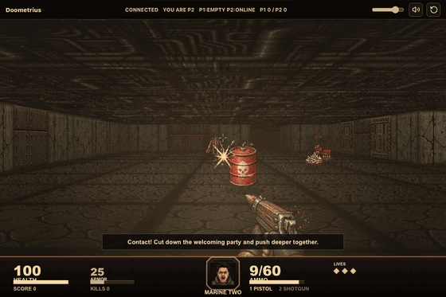

# Doometrius

A two-player co-op, Doom-style shooter that runs in the browser, built from scratch in TypeScript with a custom raycaster and an authoritative multiplayer server.



Fight through the Blacksite Breach with a friend: clear the rooms, take down the Sahurwood boss, and reach the extraction lift.

## Highlights

- Raycasting renderer on a 2D canvas: textured walls, floors, ceilings, and sprites
- Authoritative WebSocket game server with client-side prediction, reconciliation, and snapshot interpolation
- Two weapons, pickups, enemy waves, and a three-phase boss fight
- Synthesized sound effects and music using the Web Audio API

## Run it

Requires Node.js 20.19 or later.

```bash
npm install
npm run dev
```

Open http://localhost:5173. This starts the game server on port 8787 and the Vite client on port 5173. To play co-op, a second player on the same network opens the same page at your machine's IP address.

## Controls

| Action | Keys |
| --- | --- |
| Move | W A S D |
| Turn | Mouse (click the game to lock), Q / E, or arrow keys |
| Sprint | Shift |
| Fire / start | Left click or F |
| Reload / restart | R |
| Switch weapon | 1 / 2 or mouse wheel |

## Tech stack

TypeScript, React, Vite, Canvas 2D, Web Audio, and Node.js with `ws`.
